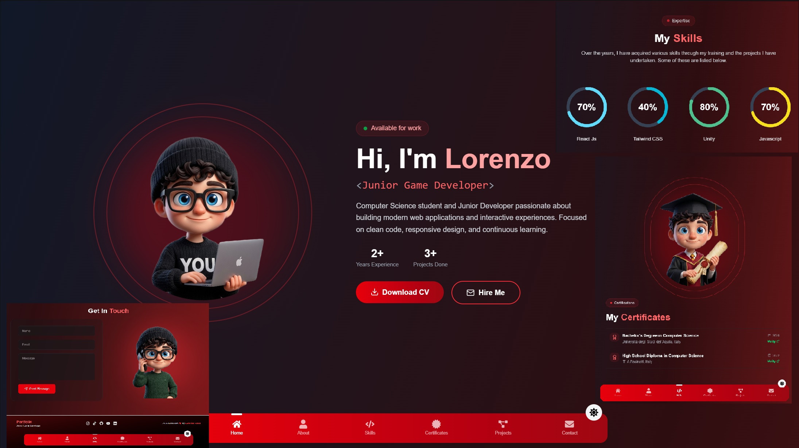

# Personal Portfolio - Frontend

A modern, responsive personal portfolio built to showcase my projects, technical skills, and experience. Instead of relying on static data, this frontend dynamically fetches project information from a custom PHP & MySQL backend.

🔗 **Live Demo:** [feulalorenzo.gamer.gd](https://feulalorenzo.gamer.gd)

---

## Preview



---

## Features

- **Dynamic Content:** Fetches projects and details in real-time via REST API calls.
- **Responsive Design:** Fully optimized for desktop, tablet, and mobile devices.
- **Fast & Lightweight:** Built with Vite for rapid development and optimized production builds.
- **Scalable Architecture:** Designed to work alongside a dedicated mobile dashboard app (built with Expo/React Native) for effortless content updates.

---

## Tech Stack

- **Framework:** React / JavaScript (ES6+)
- **Build Tool:** Vite
- **Styling:** CSS3 / Tailwind CSS *(adjust based on what you used)*
- **Hosting:** InfinityFree

---

## Getting Started

To run this project locally on your machine:

1. **Clone the repository:**
   ```bash
   git clone https://github.com/feulalorenzo/portfolio
   cd portfolio
   ```

2. **Install dependencies:**
   ```bash
   npm install
   ```

3. **Configure API Endpoint:**

   Update the fetch URL in your code to point to your backend API (e.g., `https://feulalorenzo.gamer.gd/api/...`).

4. **Start the development server:**
   ```bash
   npm run dev
   ```

5. **Build for production:**
   ```bash
   npm run build
   ```
   Upload the contents of the generated `dist/` folder to your web hosting root (`htdocs`).

---

## Contact

**Lorenzo Feula**  
- Portfolio: [feulalorenzo.gamer.gd](https://feulalorenzo.gamer.gd)
- LinkedIn: [Lorenzo Feula](https://www.linkedin.com/in/your-profile)